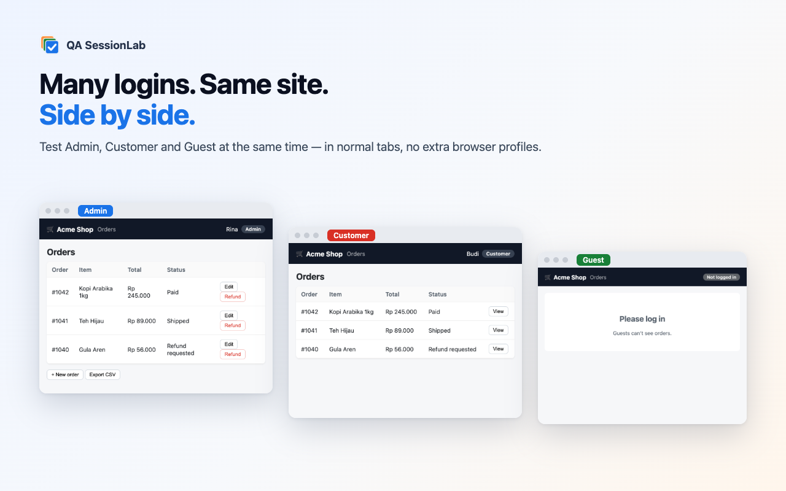

# QA SessionLab

[](https://github.com/adyfk/qa-sessionlab/actions/workflows/ci.yml)
[](LICENSE)

**Many logins on the same site, side by side, in normal tabs — built for QA.**

A Chrome / Edge extension (Manifest V3) that turns tabs into isolated sessions, so you can be Admin, Customer and
Guest on the same app at the same time — plus a role matrix, state snapshots, device/locale/network emulation,
a bug recorder that writes the report for you, test-data tools, and an MCP bridge so AI agents can test with it.

**[Website](https://adyfk.github.io/qa-sessionlab/)** · [Bahasa Indonesia](README.id.md) · [Architecture](docs/ARCHITECTURE.md) · [Contributing](CONTRIBUTING.md) · [Security](SECURITY.md) · [Changelog](CHANGELOG.md)



## Features

| | |
|---|---|
| **Isolated sessions per tab** | Each session has its own cookie jar plus namespaced `localStorage`, IndexedDB, Cache Storage and BroadcastChannel — also inside Web Workers when the site's CSP allows it. Your normal profile is never touched. Sessions get coloured tab groups, a badge and a `[Role]` title prefix. |
| **Real-browser cookie rules** | RFC 6265 matching, `HttpOnly`, `Secure` (incl. `localhost`), and `SameSite` for cross-site requests. |
| **Inheritance** | `target=_blank`, middle-click and `window.open` stay in the session; plain new tabs stay in the normal profile. |
| **Role matrix** | Open one URL as several roles in tiled windows and drive them together — the fastest RBAC check. |
| **Snapshots** | Save the logged-in state (cookies, localStorage, IndexedDB) and restore it after destructive tests. |
| **Sharing & automation** | Encrypted session sharing with teammates (AES-256-GCM + passphrase), Playwright `storageState` export/import, clone your normal login into a role, full backup/restore. |
| **Environment emulation** | iPhone/Android/iPad/desktop viewports, offline/3G/4G, locale + `Accept-Language`, timezone (incl. `Date` math), dark mode, reduced motion, geolocation — per session. |
| **Bug recorder** | Records steps (passwords masked), console errors, failed requests and screenshots, then writes a paste-ready Markdown report. |
| **Test data** | Unique emails, phone numbers, addresses, sandbox payment cards, 28 edge cases (boundaries, unicode, RTL, emoji, injection probes); fill whole forms from the right-click menu. |
| **AI control (MCP)** | 27 tools for Claude Code, Claude Desktop, Cursor or any MCP client — create roles, open pages, read/click/type, compare roles, record bugs. |
| **6 languages** | English, Bahasa Indonesia, Español, Português (BR), 日本語, 简体中文 — follows the browser or pick one in Settings. |
| **Private** | No servers, no analytics, no remote code. |

## Use cases

Step-by-step answers for the problems QA teams search for most:

- [How to log in to multiple accounts on the same website in Chrome](https://adyfk.github.io/qa-sessionlab/solutions/multiple-accounts-same-site/)
- [How to test user roles and permissions (RBAC) side by side](https://adyfk.github.io/qa-sessionlab/solutions/test-user-roles-permissions-rbac/)
- [Reuse a manual browser login in Playwright (storageState)](https://adyfk.github.io/qa-sessionlab/solutions/playwright-storagestate-from-manual-login/)
- [Let an AI agent test your web app as multiple users (MCP)](https://adyfk.github.io/qa-sessionlab/solutions/ai-agent-browser-testing-mcp/)
- [Write complete bug reports from Chrome automatically](https://adyfk.github.io/qa-sessionlab/solutions/bug-report-console-network-chrome/)
- [Test one web app as different devices, locales and networks at once](https://adyfk.github.io/qa-sessionlab/solutions/test-different-devices-locales-network/)
- [Comparison: Chrome profiles vs incognito vs separate browsers vs QA SessionLab](https://adyfk.github.io/qa-sessionlab/compare/)

## Install (1 minute)

1. **[⬇ Download qa-sessionlab.zip](https://github.com/adyfk/qa-sessionlab/releases/latest/download/qa-sessionlab.zip)** (latest release) and unzip it.
2. Open `chrome://extensions` (Edge: `edge://extensions`) and switch on **Developer mode** (top right).
3. Click **Load unpacked** and select the unzipped folder.
4. Pin the extension (🧩 icon in the toolbar). A welcome page opens with a one-click setup.

Works in Chrome, Edge, Brave and other Chromium browsers (version 116+). To update, unzip the new version over the same
folder and click ↻ on the extension card. All versions: [Releases](https://github.com/adyfk/qa-sessionlab/releases).

<details><summary>Build from source instead</summary>

```bash
git clone https://github.com/adyfk/qa-sessionlab.git
cd qa-sessionlab
npm ci
npm run build    # then "Load unpacked" → dist/
```
</details>

## Quick start

1. Open the site you test → click the extension icon → type a role (e.g. *Admin*) → **+ Open**. Log in in that tab.
2. Repeat for *Customer*, *Guest*… (or **Panel → Quick roles → + RBAC set**).
3. **Panel → Matrix** → pick roles → **Open side by side** to compare what each role sees.
4. Found a bug? `Alt+Shift+R`, reproduce, `Alt+Shift+R` again → **Copy report**.

| Shortcut | Action |
|---|---|
| `Alt+Shift+S` | open the popup |
| `Alt+Shift+N` | current page in a new temporary session |
| `Alt+Shift+R` | start / stop bug recording |

## AI control (MCP)

AI control is on by default and protected by a token.

1. **Panel → Settings → AI control** → copy the **Token**.
2. Register the zero-dependency MCP server (Node ≥ 18):
   ```bash
   claude mcp add qa-sessionlab -e QSL_TOKEN=<token> -- node /path/to/qa-sessionlab/tools/mcp/qsl-mcp.mjs
   ```
   Other clients: run `node tools/mcp/qsl-mcp.mjs` with `QSL_TOKEN` (and `QSL_PORT` if you changed the port).
3. Settings shows **● connected**.

Example prompt: *“Create Admin and Customer, log in to http://localhost:3000 as each, then compare /orders for both
roles and report permission differences.”*

Main tools: `qsl_create_session`, `qsl_open`, `qsl_read_page`, `qsl_click`, `qsl_type`, `qsl_wait_for`,
`qsl_compare_roles`, `qsl_screenshot`, `qsl_start_recording` / `qsl_stop_recording`, `qsl_snapshot` /
`qsl_restore_snapshot`, `qsl_update_session`, `qsl_export_storage_state` (27 in total).

## How isolation works

Short version (details in [docs/ARCHITECTURE.md](docs/ARCHITECTURE.md)):

- **Network:** per-tab `declarativeNetRequest` rules replace the `Cookie` header with the session's jar
  (SameSite-aware); `Set-Cookie` is captured with `webRequest` and rolled back from the browser's real jar.
- **Page:** a MAIN-world content script reads the session payload **synchronously** from a `Server-Timing` header the
  rules add, so isolation is in place before the page's first script runs.
- **Cache:** documents and API calls in session tabs bypass the HTTP cache, so roles never see each other's cached data.
- **Workers:** service workers, shared workers and speculative prerendering are disabled for sessions because their
  requests can't be tied to a tab.
- **Login redirect race:** MV3 can't pause requests, so the redirect right after a login is usually sent with stale
  cookies. SessionLab detects it and replaces that navigation before the stale page renders (`npm run bench:race`).

### Known limitations

| Area | Behaviour |
|---|---|
| Workers on sites with a strict CSP | If the CSP forbids `blob:` workers, storage *inside* workers isn't namespaced (to avoid breaking the app). Page storage still is. |
| SPA login via XHR | If an app fires another API call *immediately* after an XHR login, that first call can lose the race; a reload fixes it. |
| HTTP Basic Auth | Credentials are managed by the browser and shared by all tabs. |
| "Save link as…" | Downloads started from that menu don't carry session cookies. |
| `SameSite=Strict` on cross-site navigations | Treated like Lax. |
| Device / network emulation | Uses `chrome.debugger`, so Chrome shows a "started debugging" bar on those tabs. |
| Firefox | Not yet — Firefox has native containers; a port is planned. |

## FAQ

**How do I log in to multiple accounts on the same website in Chrome?**
Create one session per account (e.g. *Admin* and *Customer*) and open the site in each session tab. Every session keeps
its own cookies and storage, so all accounts stay logged in side by side in one window.

**How is this different from Chrome profiles or incognito?**
Profiles need separate windows and incognito gives one extra session. QA SessionLab gives unlimited isolated sessions as
normal tabs, plus QA tools (role matrix, snapshots, emulation, bug recorder, test data).

**Is it an alternative to SessionBox / MultiLogin-style extensions?**
Same multi-session idea, but built for software testing (RBAC checks, bug reports, Playwright export, AI control) — and
free, open source, with no account or tracking.

**Can I reuse a manual login in Playwright?**
Yes: export a session as Playwright `storageState` JSON, or import one to create a session.

**Can AI agents use it?**
Yes, through the built-in MCP server (27 tools), local-only and token-protected.

## Development

```bash
npm run dev           # watch build into dist/
npm run check         # typecheck + unit tests + build + all e2e suites (what CI runs)
npm run bench:race    # measure the login-redirect race
npm run ui:shots      # screenshots of every UI screen
node store/make-assets.mjs   # regenerate the store images from the real UI
```

End-to-end tests need Chromium from Playwright: `npx playwright install chromium`.
See [CONTRIBUTING.md](CONTRIBUTING.md).

Publishing to the Chrome Web Store / Edge Add-ons: everything you need is in [`store/`](store/LISTING.md)
(listing text in 6 languages via `_locales`, permission justifications, privacy policy, images).
Tagging `vX.Y.Z` builds, tests and attaches `qa-sessionlab.zip` to a GitHub release.

## License

[MIT](LICENSE)
